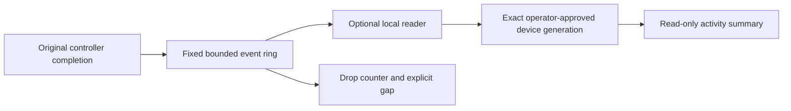

# Toward trustworthy storage activity

M5.24 investigated the pinned original simulator; it did **not** add a live feed,
patch SIMH or enable a monitor listener. The current browser consumes explicitly
approved snapshots. See the [capture contract](storage-observation.md) and
[measured guest results](../lab/M5.24.md).

## Available mechanisms and their limits

The original RP module has request-start/completion and register debug categories;
RL similarly has operation/register/trace/data categories. `sim_disk.c` and
`sim_tape.c` contain sector/record and asynchronous completion debug points. Those
are useful diagnostic evidence, but the common `_sim_debug` path in `scp.c` formats
and writes to a FILE stream. Logging can block or consume unbounded disk space;
some categories disclose guest bytes or host pointer values. A diagnostic line is
not a stable, authenticated device-generation event protocol. M5.24 did not enable
these logs in the guest tests or qualify them as a passive browser feed.

The FrontPanel API's register collection uses remote-console sampling commands
(`repeat`, `collect`, `sampleout`) and mutable sampling state. It is not an already
qualified passive channel. Named `EXAMINE` reads controller backing variables but
also calls the REALCONS register-examine event path in this original build. Direct
memory-mapped address reads can invoke device behavior. Neither approach is suitable
for unattended polling merely because a command is called “examine.”

M5.24's bounded TM MTS/MTC/MTBRC/MTCMA/UST/POS and RP CS1/DS/ER1/DA/DC named captures
are qualified **only** at independently verified idle-then-halted lab boundaries,
with REALCONS disconnected. RP's per-drive DS ready bit and ER1 have different
meanings from its local CS1 representation; CS1 RDY=0 did not imply an unready drive.
TM EOF sets the controller error summary during normal filemark traversal. No
physical REALCONS coexistence or concurrent register-sampling safety is established.

These findings come from [pinned original sources](https://github.com/obsolescence/pidp11/tree/26d20beda0c6b5a1d3a5cb3d7a4dd494e02bff75/src/02.3_simh/4.x%2Brealcons/src),
particularly `PDP11/pdp11_rp.c` (`rp_go`, `rp_svc`, `rp_io_complete`),
`PDP11/pdp11_rl.c`, `sim_disk.c`, `sim_tape.c`, `scp.c` (`ex_reg`, `_sim_debug`),
`sim_frontpanel.c` and `sim_console.c`. [Source hashes](../../lab/m524/results/sources.json)
identify the exact reviewed files.

## Bounded experiment proposed for a later milestone

A minimal, optional instrumentation experiment could emit **completed operation
metadata only** from the original controller completion path. It must not claim to
have zero effect on timing: extra work always has potential cost. Begin with one
controller and a separately identified disposable build; retain an unmodified
control build and compare guest bytes/status, command completion and timing.

Candidate constraints, **targets rather than measurements**:

- Fixed 256-entry × 64-byte ring (16 KiB), allocated before execution; no allocation,
  formatting, file writes, socket waits or observer-held locks in the device path.
  Asynchronous I/O requires explicit concurrency/memory-order review, not an assumed
  single producer. On pressure, drop events and increment a bounded overflow counter.
- Include source-instance nonce, configured controller/unit, attachment-generation
  nonce, monotonically increasing sequence, simulated timestamp, operation type,
  requested/completed byte counts and completion status. Never include guest bytes,
  arbitrary paths or an executable command. Model events are not physical motion.
- Bind source lifetime and attachment transitions to independently approved guest
  and media identity. Attachment changes retire the generation before subsequent
  events are exposed. PID/socket survival cannot establish guest identity; uncertain
  guest changes require a new operator attestation and approval.
- Summarize at most ten times per second with at most four devices and a small fixed
  payload (target ≤4 KiB). Preserve loss/unknown status; a gap is not idle. No event
  or heartbeat must expire displayed activity, never preserve a spinning reel.
- The optional reader's disconnect, crash or slowness must not stop the guest,
  delay device completion or write guest media. Restart starts detached, discards
  prior generations and cannot restore authority. No upstream command channel.
- Initial incremental targets: ≤1 MiB companion memory, ≤1% of one Pi 3B+ core at the
  qualified workload, and p95 event-to-view ≤250 ms at ten updates/second. These
  require direct measurement; the current snapshot timings do not establish them.
  Future companion containment remains enforced 96 MiB with zero swap; the simulator
  must remain outside the optional companion's failure/stop boundary.

Acceptance would compare enabled/disabled outputs and guest status, exercise queue
saturation, malformed events, missing/reordered sequences, concurrent completion,
attachment replacement, source restart, reader kill and browser disconnect. Review
REALCONS interactions independently before considering any physical experiment.
No proposed mechanism is approved for production, and no implementation or Pi
operation is implied by this document.
