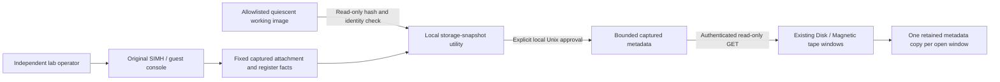

# Captured disk and magnetic-tape observations

M5.23 implements an explicitly approved **snapshot**, not continuous storage
telemetry. The original simulator and guest console remain independent. The browser
cannot mount/eject media, move tape, issue monitor commands or start/stop a guest.
The [inventory](storage-inventory.md), [lab report](../lab/M5.23.md) and
[runbook](../../lab/m523/README.md) identify the tested subset.

## Why snapshots first

The pinned simulator exposes named storage registers and has FrontPanel API 12.
These are not automatically safe production observation channels. In its original
`scp.c`, `exdep_reg_loop` reads named register storage through `get_rval`; `ex_reg`
also emits a REALCONS register-examine event when compiled with REALCONS. Examining
memory-mapped device addresses can instead invoke device read logic, which may
change device state. These operations are not interchangeable.

`sim_frontpanel.c` constructs remote-console register queries using `repeat`,
`collect` and `sampleout`; `sim_console.c` maintains the corresponding sampling
state. That interface merits a later, narrowly scoped review. M5.23 neither exposes
it nor assumes its broader console/lifecycle behavior is passive. No source patch,
monitor listener or production instrumentation was added.

In the isolated lab, the independent operator pauses an already idle guest or uses
a halted diskless CPU test, with REALCONS disconnected. A small fixed set of `SHOW`
and **named** `EXAMINE` commands captures controller variables. The local collector
never runs those commands or contacts the simulator. Readiness to pause, attachment,
guest identity and guest-access claims remain independent operator attestations.

## Three separate claims

1. **Configured:** the original simulator identifies the device/controller/unit.
2. **Attached:** the independent console identifies the actual working image. The
   collector separately checks its exact length and SHA-256 at the quiescent boundary.
3. **Guest access:** a conventional guest command has independently demonstrated
   filesystem/volume access. CPU DMA tests are a different evidence category.

The qualified RL02 has all three. The TM11 test has the first two plus actual CPU
DMA/filemark/end-of-image behavior; guest tape-driver access remains unavailable.
A path, file timestamp, controller done bit or successful directory listing does
not create a live block-I/O feed. Activity is always `unavailable` in this contract.

## Bounded records and state

`internal/storage` supports only `RL0/RL11/RL02` and `TM0/TM11/TU10`, unit zero.
The general ceiling is four configured slots, but duplicate devices are refused;
this milestone therefore has at most two qualified device records. Other inventory
families are deliberately rejected until qualified. No database or background
collector is required.

Every captured record includes:

| Fields | Exact evidence source / meaning |
|---|---|
| Simulator, guest, capture ID | Independent operator identities; guest OS is not inferred from a PID/socket |
| Controller, device, unit, family, configured | Original device definition and captured `SHOW` output |
| Attachment, media label, format | Independent `SHOW unit` plus reserved working-media provenance; no public host path |
| Size and SHA-256 | Read-only hash of the entire quiescent allowlisted file, at capture time |
| Capacity and geometry | Configured model and original source; not necessarily host-file length |
| Write protection | Captured simulator unit mode and attachment flags; host permissions alone are insufficient |
| Guest access and evidence | Independently verified original-console utility result; unavailable for the tape CPU test |
| Ready/error and raw registers | Named controller variables at the halted capture boundary; not hardware bus reads |
| Tape position | SIMH unit's logical image byte offset; not host stream cursor, record number or feet of tape |
| Filemark / end of medium | Original status and known CPU read sequence, separately from transport-length EOT |
| Captured time | Host UTC capture time, never the historical guest's clock |
| Generation | New random service-instance/capture identity on every accepted publication |
| Source/provenance | Bounded human-readable verification description |
| Freshness | `observed` capture initially, `stale` after 30 seconds, or explicitly `disconnected` |

The immutable facts retain the `captured-snapshot` mode in every state. “Observed”
means a recently accepted capture, **not currently connected equipment**. Clock
rollback also expires freshness; an expired record cannot become fresh again.
An absent capture is unavailable; uncertain facts are unknown. Simulation is a
separate local mode. No missing update is translated into idle/no activity.

Each private request is at most 8 KiB. Evidence strings are bounded to 512 ASCII
characters; identity tokens are bounded, counters/enums are checked and media hashing
is limited to 256 MiB. Capacity may describe a larger logical device, but no media
beyond the collector bound is accepted. Metadata responses are bounded by slot/field
limits. `Store.mu` protects records and revision; encoding and network writes occur
after copies leave that lock. Slow readers cannot block revocation or the guest.

## Local publication and retirement

The service's private configuration adds `storage_snapshots`, containing only
allowlisted `{id, device, controller, unit}` tuples. It contains no current capture,
media pathname or persistent approval. Startup always creates an empty store and a
new instance nonce. Existing terminal/device authorization remains unchanged.

The private Unix socket provides:

- `GET /storage/status`: instance and revision, no approval.
- `POST /storage/publish`: explicit verification, exact instance/revision and bounded
  snapshot. Validly sequenced publication attempts consume the revision even when
  facts fail validation. New capture IDs/timestamps are required; replay is refused.
- `POST /storage/revoke`: exact instance/revision, device ID and generation. Captured
  facts remain available as disconnected data, never a live connection.

The browser has authenticated `GET /api/v1/storage` and
`GET /api/v1/storage/{id}/{generation}` using the existing device-observe capability.
No mutation route or path/monitor input is registered publicly. Replacing a capture
retires its previous URL. Restart loses all captures; old URLs return 404.

A local operator uses `storage-snapshot -config PRIVATE_JSON
-independent-capture-verified` only after an independent capture. The reserved
0600/0640 configuration contains the Unix socket, one absolute `media_path` and the
snapshot. `VerifyMedia` opens with read-only/no-follow/nonblocking flags, rejects
nonregular or oversized files, hashes bounded bytes and compares descriptor/path
identity, size and modification time before/after. Changed/removed/replaced media
fails. It never writes media. Then one status/read and one revision-bound publication
occur; uncertain replies are not retried.

This is a trusted local operator boundary, not cryptographic proof of attachment.
A malicious same-user operator can forge attestations and hashes. Parent-directory
administration, live-media races and surviving-process guest changes cannot be solved
by metadata alone. Quiescence and actual attachment must be independently verified.
Intentional transitions require explicit retirement first. An unreported transition
can make captured facts obsolete immediately: the UI always says current state is
unknown, even during the 30-second freshness window. No automatic transition detector
or production approval is claimed.

## Browser behavior

The existing equipment windows offer Local simulation, Read-only observation and
Retained snapshot. Opening observation does not fetch or select anything. Refresh
lists captures; viewing requires an explicit generation choice. Every field is
validated and compared with the selected inventory identity. Changed facts, stale
URLs and late replies cannot silently select a replacement.

A one-second local timer updates freshness only; it never fetches media or invents
activity. Stop viewing cancels pending work. Switching modes/closing cancels requests
and disposes the timer. One copied metadata record per window can be viewed in
Retained snapshot without network access. Closing the window loses it; no durable
archive, auto-import or restored device authority is implemented.

The older `media-observation.ts` descriptor remains a separate future-interface
fixture. Its `busy`/position vocabulary is not treated as proof of genuine telemetry.
The new narrow snapshot contract does not promote that demonstration into hardware.
