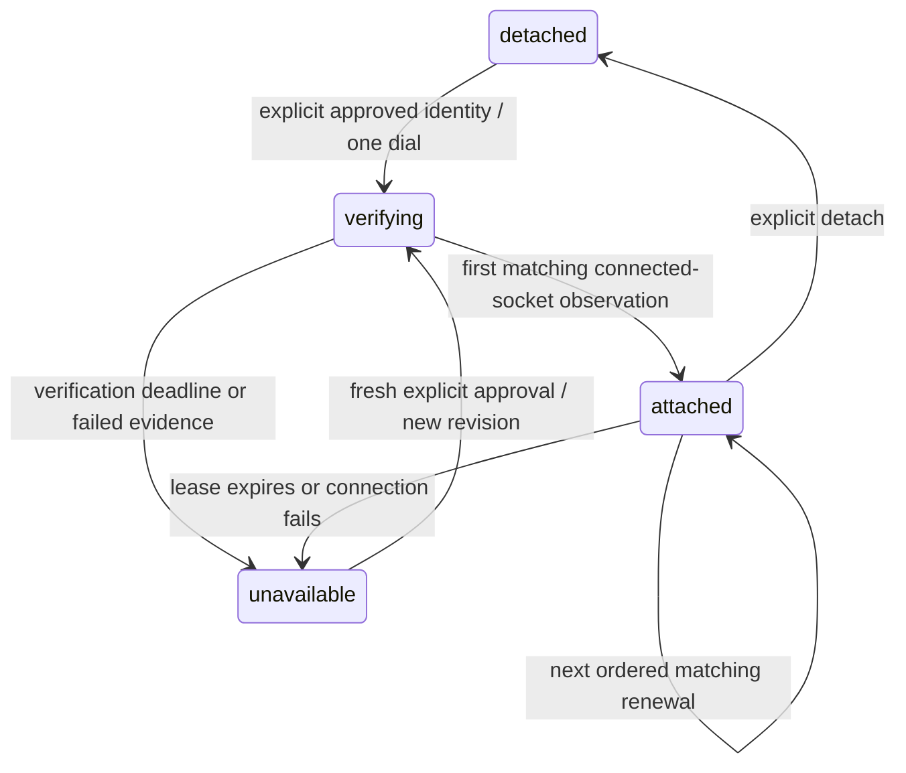

# Supervised guest attachments

M5.12 adds an opt-in attachment contract for controlled Linux laboratories. It
does not discover the operating system inside SIMH, install an observer, or
control the emulator. Existing manually approved endpoints retain their current
behavior. See the [M5.12 report](../lab/M5.12.md) for qualification and limits.

## Four different identities

| Identity | Evidence | What it cannot establish |
| --- | --- | --- |
| Simulator process | Linux pidfd; PID and start time; boot and namespace identities; executable inode | Which guest is executing inside the process |
| Terminal endpoint | One allowlisted loopback listener and the accepted connection descriptor owned by that process | Whether the guest has reset or replaced its OS without changing sockets |
| Guest approval | Explicit operator verification and a fresh operator epoch | Independently measured OS identity |
| Browser attachment | Service instance, line revision, viewer membership revision and separate keyboard lease | Continued authority after another attachment replaces it |

The private configuration can name `supervised_endpoints` from its existing
endpoint allowlist. A named line rejects ordinary manual attachment. The local
observer must provide all three bounded identity fields with the ordinary
instance/revision approval. These strings are assertions from a trusted local
observer; the Go service does not independently inspect `/proc`.

The initial verification window is three seconds and grants **no browser
access**. A TCP handshake may precede SIMH's polling and acceptance of its socket.
The lab observer waits up to 2.5 seconds for that first accepted descriptor; it
does not redial or replay approval. Once verified, each renewal extends authority
by one second. The observer samples approximately every 200 milliseconds.

Renewals travel over the existing private Unix socket. They must match the
service instance, line revision, all approved identities and the next sequence
number. Replays, reordered messages, changed identities and late renewals are
refused. Expiry retires the endpoint, closes its guest socket and removes browser
leases. It never signals SIMH. A resumed observer cannot revive expired authority.
The manager checks expiry on its 100-millisecond ticker and when serving status,
listing, lookup and renewal requests. These are scheduling-dependent deadlines,
not a hard real-time guarantee on an overloaded or suspended host.

## Observer boundary

[`lab/m512/supervisor.py`](../../lab/m512/supervisor.py) is a separate laboratory
tool, deliberately absent from the installation package. It requires an explicit
PID, loopback IPv4 address, private socket, operator epoch and verification flag.
It uses bounded `/proc` reads and refuses conflicting listeners, a different
network namespace, process exit, executable replacement, socket replacement or
ambiguous ownership. A pidfd pins the process lifetime even if its numeric PID is
later reused. The first renewal additionally verifies the reverse connection
tuple in a descriptor owned by the approved process.

The observer neither reads guest bytes nor accesses a monitor, GPIO, Screen,
guest disk or simulator memory. Its Linux privileges and `/proc` visibility have
only been exercised in disposable laboratories. Production installation,
least-privilege deployment and independent security review remain outstanding.

## Required operator rule

Stop the actual observer and bridge before any intentional guest change, monitor
reset, line reassignment or simulator restart. Verify the new guest and dedicated
line independently, then approve a new attachment with a new epoch. Browser
titles, prompts and model answers are never identity evidence. A new browser
connection starts read-only and needs a separate explicit keyboard acquisition.

An OS replacement inside the same process with the same listening and connected
sockets is **not detectable by this observer**. Re-execution of the same binary,
descriptor inheritance and changes between observations also limit inference.
Root or a compromised trusted observer can lie. Do not use this subset as an
unsupervised production guest-switch detector.

Older releases do not recognize the new configuration key. Rollback requires
restoring the prior reviewed private configuration while the companion is stopped;
do not assume a binary rollback also rolls back its configuration. The package
does not silently discard a requested supervision requirement.
