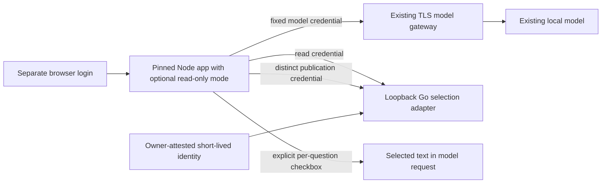

# Optional read-only Hacker Replicant mode

> This runbook describes the unchanged experimental 0.1 integration, including its companion-held publication credential. The [M5.23.1 proposal](../../docs/technical/selection-contract-0.2-proposal.md) instead places publication/consent in Web Desktop and makes Hacker Replicant consumer-only. Do not apply proposed credential ownership to these existing commands: migration and implementation need separate authorization and qualification.

This developer preview runs Rolf Peters’ [Hacker Replicant](https://github.com/rolfpeters-droid/pidp11-hacker-replicant) as a separate application. It retains his application, artwork and MIT notices, and applies a small pinned-source preparation script plus original integration modules. It is **modified upstream**, not an official plugin, an endorsement or a production installation. [Phase D evidence](../../docs/lab/M5.9.3-D.md) includes genuine model chat through its actual browser UI.

It has no operator console, `/keys` permission, terminal discovery, guest lifecycle action or shell tool. It does not join the Web Desktop service package. Run it on a capable development/model host, not the physical Pi. A model, desktop and companion may each be stopped without controlling an emulator.

## Architecture and responsibilities



The app authenticates every browser route with its own HTTPS Basic login. POST requests require its exact origin. Use a **different hostname**, not merely a different port, from the Web Desktop: browser cookies are not port-scoped. The desktop launcher enforces that distinction and supplies no token, text, referrer or opener. This preview has one owner login and one selected-text slot; it is not a multiuser service or single sign-on.

`read-only.mjs` registers before upstream chat, so the original tool loop cannot receive read-only requests. It rejects tools/cloud mode, fixes the approved model, bounds history to 12 messages/8 KiB and each message to 2 KiB, uses up to two compact reference notes, and limits answers to 4 KiB. It preserves the gateway’s 4-KiB-message/16-KiB-total limits rather than splitting a large operator prompt to evade them. No request queue or automatic retry exists. Model disconnect/deadline cancellation propagates; the runner may nevertheless retain already received text or briefly finish computation.

The adapter’s `/status` preserves `running:null`, `os:null`, and `cpu_running:"unknown"`. A confirmed identity means the owner attested to a manifest, **not** that the adapter observed a CPU or guest. `/screen` returns only previously approved text, with endpoint, attachment generation and simulator generation. Reads never refresh its 30-second maximum lifetime. Changed/absent/expired identity erases the selection on read; publication requires the current identity. A separate sharing credential protects POST/DELETE `/selection`. `/keys` always refuses. Browser-origin requests to the adapter are rejected; the Node app holds its credentials server-side.

## Reproduce the tested application

Use the **Mac development shell** at the Web Desktop repository root, with Node/npm, Go, Python, Docker and the already installed local model. Do not use a Pi alias. The two-container procedure in [lab/m593d](../../lab/m593d/README.md) is the executed acceptance path and supplies disposable keys/certificates, independent network namespaces, original application dependencies, explicit failure tests and cleanup.

To prepare a checkout manually, choose a new disposable directory:

```sh
git clone https://github.com/rolfpeters-droid/pidp11-hacker-replicant.git /absolute/path/to/disposable-replicant
git -C /absolute/path/to/disposable-replicant checkout 6f8a2aca7786736e01bdf5ba9b44bf66a7f19349
python3 integrations/hacker-replicant/prepare.py /absolute/path/to/disposable-replicant
cd /absolute/path/to/disposable-replicant
npm ci --ignore-scripts
```

The helper refuses another revision or a dirty checkout. Inspect its printed success and `git diff`; preserve upstream `LICENSE`. It neutralizes `__CONSOLE_URL__` to `about:blank` before HTML delivery in read-only mode, adds loopback TLS, independent authentication, bounded chat, selection UI and cancellation. It does not run the application, its boot API or webconsole. Changes to a future upstream revision require another review, not removal of this pin check.

## Owner-managed local configuration

The following is a local configuration recipe; the executed cross-host acceptance harness is linked above. Create a private directory outside public packages, owned by the account running these temporary processes, mode 0700. Use four **different** random credentials, each 32–128 characters, in separate regular mode-0600 files. Do not put them in command arguments, a browser URL, source control or model context.

| Environment name | Private value/path and purpose |
|---|---|
| `PIDP11_READONLY` | Must be `1`; omitting it leaves upstream’s original application mode |
| `PORT` | `8101` for this loopback example |
| `COMPANION_ORIGIN` | `https://localhost:8101`, different hostname from a desktop at `https://127.0.0.1:8448` |
| `COMPANION_CERT`, `COMPANION_KEY` | Browser HTTPS certificate and private key; must cover the chosen hostname |
| `COMPANION_LOGIN_FILE` | Private browser-login secret; username is `companion` |
| `ADAPTER_READ_FILE` | Independent readback credential file |
| `ADAPTER_SHARE_FILE` | Independent publication/revocation credential file |
| `MODEL_TOKEN_FILE` | Existing model gateway credential file |
| `ADAPTER_URL` | `https://127.0.0.1:19002/api/pidp11` |
| `LOCAL_BASE_URL` | `https://127.0.0.1:11436/v1` for the local gateway example |
| `LOCAL_MODEL` | Explicit installed allowlisted model, tested with `gemma4:12b` |
| `NODE_EXTRA_CA_CERTS` | Owner-trusted CA bundle covering adapter/gateway certificates |

Use valid certificates or deliberately trust only the temporary lab certificate. Never globally disable TLS verification. The browser login is separate from all three service credentials. The Node app must have read access to all four files; the adapter needs only its two credentials; the gateway needs only its token.

From the **Web Desktop repository shell**, build the optional Go commands:

```sh
go build -o /absolute/private/lab/model-gateway ./cmd/model-gateway
go build -o /absolute/private/lab/replicant-adapter ./cmd/replicant-adapter
```

In separate owner-controlled shells, start them explicitly using private file paths:

```sh
/absolute/private/lab/model-gateway \
  -cert /absolute/private/lab/cert.pem -key /absolute/private/lab/key.pem \
  -token-file /absolute/private/lab/model-token -model gemma4:12b

/absolute/private/lab/replicant-adapter \
  -cert /absolute/private/lab/cert.pem -key /absolute/private/lab/key.pem \
  -read-token-file /absolute/private/lab/read-token \
  -share-token-file /absolute/private/lab/share-token \
  -identity-file /absolute/private/lab/identity.json
```

The gateway defaults to native Ollama at loopback 11434; it installs nothing and exposes no runner-management operations. After setting the table’s environment variables privately, run `node server.js` inside the prepared upstream checkout. Open its separate HTTPS origin and sign in as `companion` using only the browser-login secret. Check **Machine control unavailable** and **Machine state unknown**. If those labels are absent, stop the companion rather than using its original control UI. An unsigned/untrusted certificate, wrong credential, origin mismatch or missing mode must be resolved before sharing text.

## Approve an excerpt, then retire it

1. Keep every actual guest detached for this demonstration. Prepare a clearly labeled synthetic excerpt; do not copy private console output.
2. Independently attest an identity in the adapter’s private manifest. Its JSON fields are `endpoint`, `generation`, `simulator_generation` and numeric `expires_unix_ms`. The three identifiers must be nonempty, at most 128 bytes; expiry must be in the future and at most 30 seconds away. The file must be regular, owner-private and at most 1 KiB. For this demo use identifiers such as `synthetic-tty`, `attachment-a`, `simulator-a` and compute an expiry from the current clock. Publish the complete file atomically. Do not fabricate live guest identities or refresh a manifest automatically.
3. Paste the synthetic text, select **Approve selected excerpt for 30 seconds**, then explicitly check **Include this approved excerpt in my next question**. Approval never reads a terminal. The actual usable interval can be shorter than 30 seconds because the manifest also expires.
4. Send a short question. The backend reads the approved snapshot once and marks it untrusted data in the model request. With the checkbox clear, it does not call readback. **Find sources for my question** retrieves inspectable notes without asking the model.
5. Select **Revoke shared excerpt**. Further readback fails. Expiry or revocation also clears this page’s future request history and cancels its active request. Previously displayed or delivered text cannot be recalled; another browser may retain its own history. Failed network revocation can leave the server’s snapshot until its bounded expiry, and the UI says so.
6. Stop the actual optional app and adapter processes when finished. Remove the short-lived manifest and retire the temporary credentials. The adapter clears its in-memory selection on shutdown; restart does not restore one. Stop only task-owned gateway/tunnel processes. No emulator action is required.

For live use, the manifest writer would need a separately reviewed authoritative lifecycle integration. Port reuse, a terminal title or a user-maintained generation string does not prove the simulator has stayed the same. A same-identity change between a check and a read remains possible. This milestone therefore qualifies synthetic selected-text sharing, not a safe live-guest observation service.

## Proposed interoperability discussion — not sent

A compact shared contract could let each project retain its terminal/control architecture: independently authenticated text selection; explicit endpoint, simulator and attachment generations; unknown status distinct from false/stopped; expiry/revoke; chat cancellation; and a small source-context interface. Tools should remain absent in a read-only mode. The proposed changes need Rolf’s review before any upstream-support claim. No contact or collaboration is implied by this implementation.

## M5.11 laboratory extension

The current optional module requires an exact per-publication receipt, rejects malformed chat elements, and displays the chosen local model/destination. The earlier manifest experiment remains synthetic. A separate [M5.11 harness](../../lab/m511/README.md) qualified actual V7 output using a process/attachment/sole-view lifetime guard. It is not a production identity writer and cannot detect an OS replacement on a surviving stream. [Results](../../docs/lab/M5.11.md). Run `npm run test:replicant` from the Web Desktop repository for the route regressions. No upstream merge or endorsement is implied.
